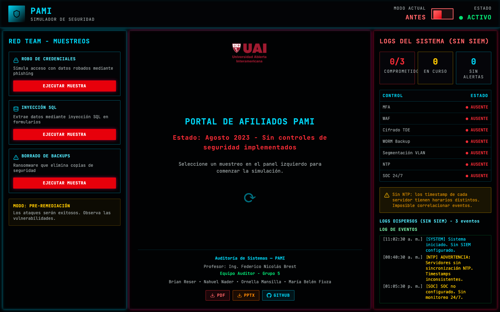
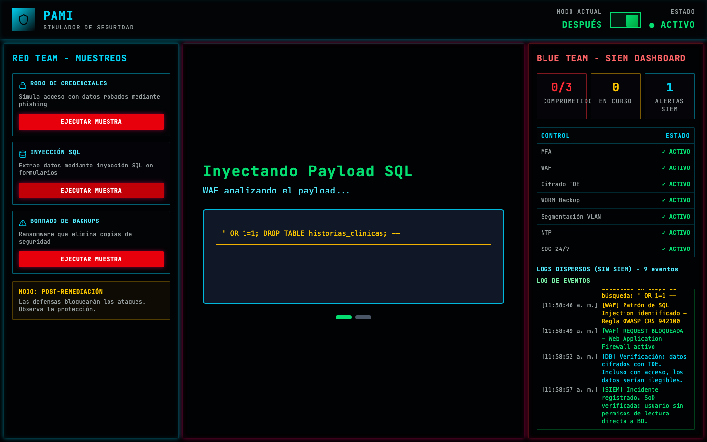

# Simulador de ciberseguridad PAMI

**English summary.** Interactive cybersecurity simulator built for the *Auditoría de Sistemas* (Systems Audit) course at Universidad Abierta Interamericana (UAI), Lomas de Zamora campus, summer 2026 (graded 10/10). It presents an audit of the PAMI affiliates portal, using a simulated replica to a non-technical audience, in two modes: a **before** mode where three attacks succeed (credential theft, SQL injection, backup deletion after ransomware) and an **after** mode where the audit's recommended controls (MFA, WAF, TDE encryption, WORM backups, VLAN segmentation, NTP, 24/7 SOC) stop them. Built with Manus AI agents, directed, reviewed and tested by the team. Educational only: it attacks no real system and has no official relationship with PAMI.

**Live demo, no installation needed:** https://brian-reser-grupo5-auditoria-uai.manus.space/

## Probalo en vivo

**No hace falta instalar nada:** abrí la demo en el navegador y ejecutá los ataques en los dos modos.

👉 **https://brian-reser-grupo5-auditoria-uai.manus.space/**





## Qué es y para qué se hizo

Es el trabajo final de una auditoría al portal de afiliados de PAMI. Los hallazgos de la auditoría están en [`AUDITORIA_HALLAZGOS.md`](AUDITORIA_HALLAZGOS.md). Para que una audiencia no técnica los entienda, en vez de una tabla de riesgos armamos un simulador: el público ve el ataque ocurrir, y después ve qué lo frena.

La pantalla tiene tres paneles:

- **Izquierda:** los tres muestreos (ataques) que se pueden ejecutar.
- **Centro:** la escena animada del ataque, con el portal de afiliados.
- **Derecha:** el estado de los controles, contadores de incidentes y alertas, y el log de eventos en tiempo real.

## Los dos modos

El interruptor del encabezado alterna entre ambos. En la interfaz se llaman **ANTES** (simulacro, pre-remediación) y **DESPUÉS** (protegido, post-remediación).

| Muestreo | Modo ANTES (simulacro) | Modo DESPUÉS (protegido) |
| --- | --- | --- |
| Robo de credenciales | Entra con una cuenta genérica, sin segundo factor, y recorre datos de afiliados y sueldos. | Se rechaza la cuenta genérica y se exige MFA; el acceso sin segundo factor se bloquea. |
| Inyección SQL | La consulta maliciosa llega a la base y expone todos los registros en texto plano. | El WAF detecta el patrón y bloquea el pedido; los datos están cifrados con TDE. |
| Borrado de backups | Un ransomware llega por red plana al NAS, borra las copias y cifra los datos. | La segmentación VLAN rechaza la conexión y los backups WORM no se pueden borrar (regla 3-2-1). |

Los siete controles que se muestran en el panel derecho: MFA, WAF, cifrado TDE, backups WORM, segmentación VLAN, NTP y SOC 24/7. En ANTES los logs salen dispersos y con horarios inconsistentes (sin SIEM ni NTP); en DESPUÉS están sincronizados y centralizados.

Todo es simulación: las cuentas, IPs, tablas y cifras que aparecen son datos de ejemplo escritos en el código.

## Stack

Según `package.json` y la configuración del repo:

- React 19 + TypeScript, con Vite 7 como bundler.
- Tailwind CSS 4 y componentes de Radix UI (estilo shadcn/ui), Framer Motion para animaciones, lucide-react para los íconos.
- Wouter para el ruteo del lado del cliente.
- Un servidor mínimo de Express que solo sirve los archivos estáticos compilados (no hay API ni base de datos).
- pnpm como gestor de paquetes.

Estructura: `client/` (la aplicación), `server/` (servidor estático), `shared/` (constantes compartidas).

## Cómo correrlo en local

Solo hace falta si querés ver o modificar el código. Para usar el simulador alcanza con la [demo en vivo](https://brian-reser-grupo5-auditoria-uai.manus.space/).

Requisitos: Node.js 20.19 o superior (requisito de Vite 7) y [pnpm](https://pnpm.io/). Probado con Node 22 y pnpm 10.

```bash
git clone https://github.com/brian-reser/reser-brian-pami-simulador-auditoria.git
cd reser-brian-pami-simulador-auditoria
pnpm install
pnpm dev
```

`pnpm dev` levanta Vite y muestra la dirección en la consola (por defecto `http://localhost:3000`).

Para generar la versión de producción y servirla con Express:

```bash
pnpm build
pnpm start
```

`pnpm start` usa la sintaxis de Mac y Linux para la variable `NODE_ENV`; en Windows conviene correrlo desde WSL o Git Bash. Queda en `http://localhost:3000` (o el puerto de la variable `PORT`). Además: `pnpm check` verifica los tipos con TypeScript.

## Contexto académico

- **Materia:** Auditoría de Sistemas.
- **Universidad:** Universidad Abierta Interamericana (UAI), sede Lomas de Zamora.
- **Docente:** Ing. Federico Nicolás Brest.
- **Período:** verano de 2026.
- **Nota:** 10.

## Equipo

Equipo Auditor, Grupo 5 (tal como figura en la demo):

- Brian Reser
- Nahuel Nader
- Ornella Mansilla
- María Belén Fiuza

## Cómo se construyó

Construido con agentes de IA de Manus (por eso los commits figuran como `Manus`), con la dirección, la revisión y las pruebas del equipo.

## Aviso

Es un simulador educativo. No ataca ni se conecta a sistemas reales, y no tiene ninguna relación oficial con PAMI ni con el INSSJP. Los incidentes y las cifras que se mencionan se usan solo con fines didácticos.
